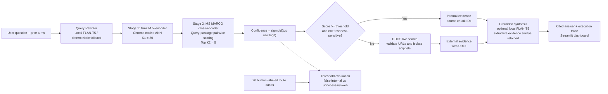

# Northstar Adaptive RAG Workbench

**Week 4 Hands-On: Production-Ready Two-Stage RAG with Query Rewriting, Cross-Encoder Re-Ranking, Confidence Gating & Live Web Fallback**  
**Student:** José Antonio Horta Herrera · **Course:** Artificial Intelligence / AI Systems Engineering · **Term:** Fall 2026

An end-to-end, **API-key-free**, two-stage Retrieval-Augmented Generation (RAG) project designed for a fictional internal cloud engineering handbook. It transforms multi-turn questions, retrieves up to **K1 = 20** candidates with normalized MiniLM vectors in **ChromaDB**, re-ranks candidates with **MS MARCO MiniLM CrossEncoder**, gates internal answers with a **sigmoid-transformed logit** (initial threshold `0.55`), and queries **DDGS** for live external evidence when the internal material is insufficient or freshness-sensitive. The Streamlit UI exposes the decisions, rank shifts, scores, sources, citations, and execution trace.

> **Verification and integrity statement (read before submitting):** The packaged project contains **12 original synthetic technical documents, 20 labeled routing evaluation questions, and 26 passing deterministic tests**. The Python tests ran in the preparation environment on November 16, 2026 (see `results/pytest_verified.txt`). **Real MiniLM, Chroma indexing, live DDGS search, FLAN-T5 synthesis and the dashboard were NOT executed here** because the prepared environment did not have the required download/runtime dependencies. A simulated test is not a substitute for a recorded live demonstration. No live calibration metrics or deployment URLs have been invented. Run the real commands below on your machine and save your output before submitting.

## 1. Architecture



### Engineering decisions

| Layer | Selected implementation | Key consideration |
|---|---|---|
| Query transformation | Local `google/flan-t5-small`, with deterministic rewrite fallback | Multi-turn pronoun expansion and exact flag preservation |
| First-stage dense retriever | `sentence-transformers/all-MiniLM-L6-v2` + Chroma persistent HNSW cosine collection | `K1=20` candidates, unit-normalized embeddings, hash-based index rebuild |
| Second-stage re-ranker | `cross-encoder/ms-marco-MiniLM-L-6-v2` | True pairwise attention over query/document, rank changes visible |
| Confidence gate | Stable `sigmoid(logit)`, initial cutoff `0.55` | **Not a calibrated probability**; script measures routing error by threshold |
| External fallback | `ddgs` Python metasearch, 3 previews | No key needed; HTTP(S) URL validation, prompt-injection filtering |
| Response generator | Local FLAN-T5 with evidence-checked output, plus always-cited extractive excerpts | Unsupported generated claims are omitted; citations must remain traceable |
| User interface | Streamlit | 20-candidate table, rerank shifts, score meter, routing reason, citation explorers |
| Packaging | `uv`, local model cache, Docker Compose | No OpenAI/Tavily/Cohere API key or paid infrastructure |

**Important:** A high sigmoid value measures a transformed scoring logit, **not** the statistical probability that a passage is relevant. Domain-specific evaluation and manual inspection are required; heuristic prompt-injection defenses also cannot guarantee immunity against adversarial inputs.

## 2. Quick start (macOS, Windows, or Linux)

Prerequisites: **Python 3.11 or 3.12**, `uv`, and an internet connection for the initial package/model downloads and for live web fallback. Start all commands from the project root.

```bash
# Install uv if necessary: https://docs.astral.sh/uv/getting-started/installation/
uv python install 3.11
uv sync --extra dev

# Optional configuration: copy .env.example to .env
cp .env.example .env

# Verify deterministic QA; no network calls needed
uv run pytest -v

# Launch interactive dashboard
uv run streamlit run src/app.py
# Open http://localhost:8501
```

On Windows PowerShell, use `Copy-Item .env.example .env` instead of `cp`. `uv sync` resolves dependencies and downloads Python packages. The first live query may download weights for MiniLM, MS MARCO, and FLAN-T5. `HF_TOKEN` is **optional**, used only if Hugging Face rate limits anonymous model downloads. No paid API key is required.

### Configurable settings

The optional `.env` file supports:

```dotenv
EMBEDDING_MODEL=sentence-transformers/all-MiniLM-L6-v2
RERANKER_MODEL=cross-encoder/ms-marco-MiniLM-L-6-v2
LOCAL_LLM_MODEL=google/flan-t5-small
REWRITE_MODE=local
GENERATION_MODE=local
CONFIDENCE_THRESHOLD=0.55
K1=20
K2=5
WEB_RESULTS=3
DOCS_DIR=docs
VECTOR_STORE_DIR=.rag_index
```

For a lighter demonstration, switch `REWRITE_MODE=deterministic` and `GENERATION_MODE=extractive`: the bi-encoder and cross-encoder remain **real**, but local FLAN generation is disabled. The dashboard also offers an extractive-only toggle.

### Docker option (local container demonstration)

```bash
docker compose up --build
# Open http://localhost:8501
```

Docker Compose persists `./.model_cache` and `./.rag_index` across container restarts. The first build and model download require access to package and Hugging Face registries. Docker manifests by themselves do not establish that a deployment was successfully executed; demonstrate your local running container in your recorded walkthrough if you choose this option.

## 3. Repository layout

```text
production-rag-pipeline/
├── pyproject.toml, .env.example, .python-version, .gitignore
├── README.md, ai_prompt_log.md, Dockerfile, docker-compose.yml
├── docs/                       # 12 original Markdown technical handbook files
├── data/eval_cases.json        # 12 internal + 8 out-of-domain routing cases
├── src/
│   ├── schemas.py              # RetrievedChunk and RAGResponse contracts
│   ├── config.py               # Environment configuration
│   ├── ingest.py               # Stable section IDs and code-fence-safe splitting
│   ├── local_llm.py            # Optional FLAN-T5 rewriting and synthesis
│   ├── rewriter.py             # Conversation-aware query transformation
│   ├── retriever.py            # Normalized MiniLM embeddings + Chroma cache
│   ├── reranker.py             # Raw cross-encoder logits + stable sigmoid
│   ├── calibration.py          # False-internal and unnecessary-web rate accounting
│   ├── web_fallback.py         # DDGS search, URL and snippet controls
│   ├── generator.py            # Evidence-first response + explicit citations
│   ├── pipeline.py             # Branching orchestration + telemetry
│   ├── factory.py              # Lazy construction of model-backed components
│   └── app.py                  # Streamlit workbench
├── scripts/
│   ├── run_smoke.py            # Optional live model / web integration example
│   └── calibrate_threshold.py  # Real score collection and threshold comparison
├── audit/initial_draft.py      # Archived imperfect AI-assisted initial draft
├── tests/                      # 26 deterministic tests across six test modules
├── results/pytest_verified.txt # Measured deterministic QA output
├── VIDEO_SCRIPT.md             # 5–7 minute demo narration
├── GUIA_ENTREGA_ES.md          # Delivery steps in Spanish
└── CANVAS_SUBMISSION.md        # Fill in live GitHub/YouTube links after recording
```

## 4. Knowledge base and query scenarios

`docs/` contains **12 synthetic Northstar Engineering Reference pages** explaining rolling deployment, connection pooling, retry budgets, idempotency, queue visibility, circuit breakers, rate limits, JWT rotation, backup recovery, tenant isolation, vector indexing, and pod disruption. Each page includes an operational overview, a configuration section, code-fenced example, runbook, and trade-off notes.

**These are fictional training documents.** Examples such as `maxUnavailable defaults to 25% in Rolling Update Deployment` describe the Northstar demonstration system only; they are not asserted as real Kubernetes, AWS, or database defaults. The original documentation was authored for this educational project family.

Sample queries to demonstrate the three required behaviors:

1. **Internal exact match:** `What is the maxUnavailable default in Rolling Update Deployment?`
2. **Conceptual internal:** `How do retry budgets prevent cascading overload during a partial outage?`
3. **Multi-turn:** first ask `Tell me about Kubernetes Worker Nodes`, then `What are its system requirements?` (shows anaphora resolution; if Northstar lacks Kubernetes worker node requirements, the engine should not pretend otherwise).
4. **Fresh web fallback:** `What is the latest AWS outage announced today?` (freshness guard routes to web regardless of deceptively high internal similarity).
5. **Forced web demo:** enable the explicit sidebar switch if the chosen out-of-scope query happens to pass the provisional threshold; disclose the override in your video.

The UI displays `original_query`, `transformed_query`, **stage-1 cosine similarity**, **stage-2 raw logit and sigmoid score**, old/new rank positions, confidence threshold, route reason, cited snippets, and downloadable JSON trace. There is no secret hidden reranker or fabricated status result.

## 5. Threshold calibration and quality methodology

The sample `0.55` is a **provisional engineering starting value, not an empirically validated optimum**. Its only job is to demonstrate branch mechanics before calibration. `data/eval_cases.json` contains 20 human-authored expected routing labels (12 internal / 8 external); it is a small educational dataset, not a production-scale relevance judgment set.

To run a real calibration using your downloaded bi-encoder + cross-encoder (the script **does not call a live web search engine**):

```bash
uv run python -m scripts.calibrate_threshold
```

This generates `results/calibration_results.json` with the **actual score for each question**, a threshold grid (`0.35 ... 0.95`) and a selected cutoff. The selection minimizes an explicit cost: **wrong internal answer = 3** versus **unnecessary web fallback = 1**, with accuracy as a tiebreaker. It reports:

- **False internal rate:** fraction of external queries wrongly classified as `INTERNAL_RAG`.
- **False web rate:** fraction of internal queries unnecessarily sent to `WEB_FALLBACK`.
- **Accuracy:** fraction of correct route labels at each threshold.

Inspect scores for mislabels, outliers, false confidence, domain shift, and manually review web vs internal needs. Set the resulting value in `.env` as `CONFIDENCE_THRESHOLD=...`; re-run the UI with fresh settings. Ideally use a separate held-out set and report performance by class. The freshness override is a separate explicit policy and is not counted in the sigmoid-only threshold calibration.

**No real calibration report is bundled:** this environment could not download/run the three models or access DDGS in the application runtime. A numeric calibration finding must come from a user's real machine execution.

## 6. Engineering audit (human-in-the-loop AI)

`ai_prompt_log.md` records the AI generation request, the imperfect baseline (archived in `audit/initial_draft.py`), a four-item audit, exact corrections, impact, and corresponding automated tests. The most serious defects and their fixes:

1. **Raw logit compared against `0.55`:** replaced with explicitly raw `CrossEncoder` outputs and a stable sigmoid before threshold evaluation.
2. **Untrusted web text appended to instructions:** replaced with validated URL search previews, sanitization, data-only boundaries, and extractive citations whose claims are tied to retrieved snippets.
3. **Naive rewriting damaged exact keys / pronouns:** replaced with context-explicit pronoun resolution and defensive validation of model rewrites.
4. **Re-embedding and duplicate indexing on reload:** replaced with SHA-256 document+model fingerprints, persisted Chroma collection and rebuild-on-change logic.

The deterministic test suite checks these corrected behaviors, but it **does not prove a production-grade jailbreak guarantee** or eliminate the need for live model integration tests.

## 7. Verified QA and limitations

```bash
uv run pytest -v
# Packaged evidence: 26 passed, 0 failed (deterministic tests)

# Live integration checks (run locally; requires models and web access)
uv run python -m scripts.run_smoke
# Writes results/live_smoke_results.json
```

| Test focus | Verification status |
|---|---|
| Pronoun rewriting, empty input, exact identifiers, local timeout | Deterministic automated tests passed |
| Sigmoid `-3/0/+3`, extreme values and threshold routing | Deterministic automated tests passed |
| Cross-encoder pairwise reorder using known stub logits | Deterministic automated tests passed |
| Internal route + document chunk citation | Deterministic automated tests passed |
| Low-confidence and freshness-triggered web routing + URL citations | Deterministic automated tests passed with web test doubles |
| Prompt injection, invalid URLs, empty web evidence, unsupported LLM draft | Deterministic automated tests passed |
| Ingestion, code fences, stable source IDs, cache invalidation fingerprint | Deterministic automated tests passed |
| Real MiniLM + Chroma corpus indexing | **Requires local integration run** |
| Real MS MARCO score distribution and empirical calibration | **Requires local calibration run** |
| Live DDGS result and clickable citation link | **Requires local integration run** |
| Local FLAN-T5 response quality and Streamlit UI | **Requires local visual review** |

Practical caveats: (a) remote web search is best effort and may be rate-limited; (b) snippet citation is not verification of a full external article; (c) CrossEncoder logits are not calibrated likelihoods; (d) regex-based injection filtering is defense in depth, not an absolute prevention mechanism; (e) this prototype has no authentication, adversarial web crawling or commercial SLA.
Canvas.

### References

- [Sentence Transformers: CrossEncoder scores and sigmoid](https://www.sbert.net/docs/cross_encoder/pretrained_models.html)
- [Chroma database documentation](https://docs.trychroma.com/)
- [DDGS package and text search API](https://pypi.org/project/ddgs/)
- [uv installation documentation](https://docs.astral.sh/uv/getting-started/installation/)

*This project is an educational prototype; use live-calibrated measurements and security review before production deployment.*
